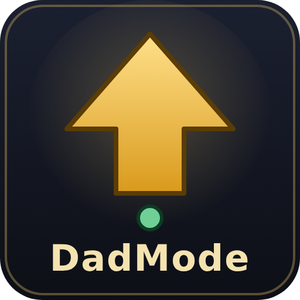

# DadMode

A World of Warcraft: Forever addon for a player who keeps losing the party.
One addon, two roles: the person who gets lost ("dad") and the people who look after him ("guides").

Version 1.21.2. Game interface 16001 (WoW Forever 1.60).

## Install

1. Unzip. You get a folder called `DadMode` with four files: `DadMode.toc`, `DadMode.lua`, `Arrow.tga`, `README.md`.
2. Put the folder in `World of Warcraft\_forever_\Interface\AddOns\`.
3. Fully close WoW and start it again. A new addon is not picked up by /reload.
4. On the character screen, click AddOns and check that DadMode is ticked.

## For dad

Nothing to set up except picking people once.

- The very first time you are in a party, a small window asks **Who do you want to find?** Click the names. Gold means picked. Press Done. It only opens by itself that one time. After that, click the gold arrow on the minimap to open it.
- Each picked person gets a **big arrow** at the top of the screen, with their name and the distance.
  - Green: close. Yellow: a bit away. Red: far.
  - Walk in the direction the arrow points.
- If you drift more than 110 yards from a picked person you see **You are far from <name>**. A soft sound plays **once**. After that only the text comes back, once a minute, with no sound, until you are near again.
- If someone calls you, you hear a sound, see their name in big text, and their arrow turns **white and pulses**. Walk to it.

The one rule: **white pulsing arrow and a beep means someone is calling you. Walk to the arrow.**

The text goes away after 10 seconds. The arrow keeps pulsing until you reach the person, for up to a minute. When you get there you see **You found <name>**. To clear a call yourself, **click the big text**.

**The green FOLLOW button.** Under the arrows there is a big green button, like **FOLLOW Anna**. Click it and your character walks after that person by itself. It follows the first person you picked. While someone is calling you, it follows the caller and **flashes white** with the text **CLICK TO FOLLOW <name>**. Following stops when you press a movement key, and the person has to be fairly close for it to start.

The button only flashes when the caller is close enough to be followed, about 30 yards. If the caller is further away or in another zone it stays calm, and the call text on screen says how many yards away the caller is. In a dungeon, where the game gives no distances, it flashes when the caller is in sight.

**Settings.** All settings are on one page inside the game's own options: press **Esc**, then **Options**, then **AddOns** on the left, then **DadMode**. Three shortcuts go to the same page: the **Settings** button in the small DadMode window, a right click on the minimap button, and `/dadmode settings`. Each line has one button. Click it to switch to the next choice:

| Line | Choices |
|---|---|
| Who uses this computer | Someone being guided, or a guide |
| Show calls from the party on my screen | On, Off |
| Sound when someone calls | Soft ding, Map ping, Bell, Ready check, Horn (loud), No sound. Each click plays the sound |
| Sound when I drift far away | The same six |
| Far-away warning | On, Off |
| Green follow button | Shown, Hidden |
| Arrow size | Small, Medium, Large |
| Window size | 80%, 90%, 100%, 110%, 125%. Makes every DadMode window and bar smaller or bigger |
| Guide bar layout | 2 columns, 1 column |
| Try it: show a call on my own screen | Shows what dad sees: sound, text, and the pulsing arrow |
| Reset window sizes | Puts every window back to the size it came with |
| Arrows and follow button | Locked, or Unlocked so they can be dragged to a new spot |
| Compare items with his gear (tooltips and drops) | On, Off. Guides only |
| Minimap button | Shown, Hidden |

To start with, a call is the Ready check sound and far away is the quiet Map ping, so the two can be told apart by ear.

**Resizing by dragging.** Three windows have a small grip in the bottom right corner. Hold the left mouse button on it and drag, like a window in Windows:

- **How is dad doing**: becomes wider or taller, and the text re-wraps to fit.
- **The small DadMode window** and **the guide bar**: the whole window grows or shrinks, buttons and text together. The top left corner stays where it is.
- **The guide bar has a break point.** Drag it narrow and the buttons jump into one column. Drag it wide again and they go back to two. That is the same choice as **Guide bar layout** in the settings.

The size is remembered. The guide bar cannot be resized during a fight. **Window size** in the settings still works and applies on top, to everything at once. **Reset window sizes** in the settings, or `/dadmode resetsize`, puts it all back.

During a fight the game does not let an addon open the options window, so the shortcuts open the small DadMode window with the settings folded out instead.

To change who you follow, type `/dadmode`.

## What happens by itself

Kept deliberately short, so dad is not pestered.

| When | What dad sees |
|---|---|
| First party ever, nobody picked | The picker window opens. Once in a lifetime |
| Later parties where nobody is picked | One line in chat, at most every 10 minutes |
| A picked person is in the party | Arrows, and the green follow button |
| He drifts far away | One soft sound, then silent text once a minute |
| Someone calls or sends a marker | Sound, big text, pulsing arrow |
| He arrives | A short green message |
| A guide asks how he is doing | Nothing. His addon answers silently |
| Login, reload, loading screens, new zones | Nothing |

Guides are never asked to pick anyone.

## Roles: being guided, or a guide

Each computer running DadMode is one of two things:

- **Being guided** ("dad"): sees calls, gets the far warning and the follow button, and answers when a guide asks how he is doing.
- **A guide**: gets the guide buttons. Calls, far warning and follow button are off, because a guide is not the one who gets lost.

**The role is asked once.** The first time DadMode starts on a computer, a small window asks **Who is using DadMode on this computer?** with two buttons: **I need help finding my party** and **I am a guide for someone**. After that it is never asked again: not at login, not on reload, not when entering a dungeon or a new zone. The answer is saved for the whole game account on that computer. A computer that already used an earlier DadMode is not asked at all and keeps the role it had.

To change role later, type `/dadmode role`. That reopens the same question. There is deliberately no role switch in the everyday window, so it cannot be flipped by accident.

**If calls end up switched off** for someone being guided, a red button **CALLS ARE OFF (click to fix)** appears in his window, and he gets a line in chat when someone calls him. One click repairs it. The caller sees **calls are off** on the guide bar.

## For the guides

Choose **I am a guide for someone** when DadMode asks at first start (or type `/dadmode role`). A compact bar with eight buttons appears. Drag it where you want it. The small **-** in its corner folds it up to just the title and the call status, and **+** opens it again. **Guide bar layout** in the settings switches between two columns and one narrow column.

Four buttons do two things each. Rest the mouse on a button to see what it does.

| Button | What it does |
|---|---|
| Call dad | Beep and big text on his screen, and your arrow pulses white until he reaches you. While a call is running the button is red and reads **Cancel my call**: click it to take the call back |
| Come to me / Stop, wait here / Follow me | Same as a call, with that message |
| Waypoint for dad | Puts a marker on dad's map and makes the game track it for him. See below. Once he has it, the button is red and reads **Remove his waypoint**. A right click always removes it |
| Star on my head | **Left click** puts a target marker on you, so he can see which character is you. **Right click** switches to the next icon. Give each guide a different one |
| Beam on the ground | **Left click**, then click the ground: a coloured beam marks the spot. **Right click** removes the beam |
| How is dad doing | Opens a window with dad's status and his quests. See below |

To see what dad sees when he is called, use **Test a call** in the settings, or `/dadmode test`.

**Warnings on the bar.** The bottom of the guide bar shows, by itself, what needs attention with the one you guide:

- **DEAD**
- **in a fight** (when you are not in one yourself)
- **bags full**, or 1 or 2 bag slots left
- **broken** gear
- unspent **talent points**

When no call is running, the most important one is also on the top line, so it shows with the bar folded up. The guide's addon asks for this short status every 45 seconds. Dad needs DadMode 1.19 or newer to answer; with an older version the warnings only update while **How is dad doing** is open.

**Version check.** The same area says when someone in the party runs another DadMode than you: "Dad has DadMode 1.14.2, you have 1.19.0". Most "it does not work" moments so far came from that. Addons tell each other their version when the party changes.

### Is this drop an upgrade for him?

No need to inspect him. The guide's addon knows what he wears and compares.

**In every item tooltip** (loot window, roll window, chat links, bags, vendors) a guide gets extra lines:

- **Dad wears [Old Cloth Hood] item level 31**
- **This one: item level 38 +7**
- **+6 Stamina, +4 Intellect, -3 Spirit**: what changes if he swaps

Other cases: **Dad has nothing in that slot**, **Dad wears this**, **Dad can not wear plate**, **This is leather. His class wears heavier armor**, **Needs level 42, he is 38**. For rings, trinkets and one-hand weapons it compares against the weaker of his two.

**When gear drops** (roll window, your own loot window, or the party's loot line in chat) you get one chat line: **Possible upgrade for Dad: [Drowned Crown] item level 38. He wears [Old Cloth Hood] item level 31.** Only for green or better items that he can wear, in his own armor type, with a higher item level than what he has in that slot, or when the slot is empty.

It shows numbers and flags a higher item level. It does not judge which stats suit his class, and it does not know which weapon types he has trained. The armor rules are the classic ones: cloth for priest, mage and warlock; leather for rogue and druid; hunter and shaman move from leather to mail at 40; warrior and paladin from mail to plate at 40.

His gear is fetched by itself when you group up and again every ten minutes. His class and level are read straight from the game on the guide's side, so the armor check works whatever version he has. He needs DadMode 1.8 or newer for the comparison at all, and 1.15 or newer for exact items with enchants. **Compare items with his gear** in the settings turns it off.

### Gear in his bags, and "put it on"

He often carries something better than what he has on. The **Gear** tab has a section **Gear in his bags**, compared with what he wears:

- **BETTER than his head [Leather Cap] item level 30**, with the stat change. The better ones come first.
- **BETTER: his main hand slot is empty**
- **not better than his head (item level 35)**
- **can not wear plate**, **needs level 45**, or **leather, lighter than his class wears**

The guide bar says **Dad: 2 better items in his bags** by itself.

**Tell him to put it on.** Under each item he is able to wear there is a link **[tell him to put it on]**. Click it and on his screen a call sounds, the text says **Anna says: put on Mail Coif**, and a big gold button appears: **CLICK TO PUT ON: Mail Coif**. One click and the item goes on. Your window then shows **he sees the button**, and **he put it on** when it worked.

- During a fight his button says to click again afterwards. The game does not allow changing armor in a fight.
- If the click does not put it on, he is told to open his bags and right-click the item, and you see that it did not work.
- The button goes away by itself after two minutes.

His addon sends up to 16 wearable things from his bags. He needs DadMode 1.21 or newer for all of this.

### Waypoint for dad

Press **Waypoint for dad** and two things happen on his screen:

- A **red, pulsing arrow** labelled **MARKER** appears next to his other arrows, pointing at the spot, with the distance. This is the part he will notice.
- The game's own pin is set on his world map and minimap and tracked.

He gets the call sound and the text **<you> put a marker on your map. Follow the red arrow**. When he gets within 15 yards the marker removes itself, he sees **You reached the marker**, and your chat says he arrived. He can also remove it with **Remove the red marker** in his picker window.

The pin on the map itself keeps the game's own look. Addons cannot recolour it, which is why the red arrow carries the signal.

Which spot is sent:

- If you have set **your own map pin** (the game's map pin on the world map), that spot is sent. So to send him anywhere: put your own pin there first, then press the button.
- Otherwise, **the spot where you are standing**.

Your chat tells you which one was used, and then whether dad's addon managed to set it. It replaces any pin dad had set himself. It does not work in dungeons, and the red arrow needs him to be on the same continent as the spot. Otherwise it says to open the map.

### When the waypoint is far away: zeppelins and flight points

If the marker is on another continent, or so far away that a zeppelin is clearly shorter, dad's addon gives him the trip in steps:

1. Big text: **Take the zeppelin to Grom'gol. Go up the tower at Orgrimmar, north side. Zeppelin master Snurk Bucksquick stands on the right platform.**
2. The red arrow is labelled **ZEPPELIN** and points to that exact platform, with the distance.
3. On the platform it says **Right platform. Wait here for the zeppelin to Grom'gol.**
4. When he lands, it says **Now follow the red arrow** and the arrow points to the marker again.

If he takes the wrong zeppelin, the addon sees where he landed and gives the next step from there.

**At a flight master.** When he opens the flight map while he has a marker, big text says **Fly to: <name>**: the flight point he can fly to that is closest to where he has to go. It only shows when flying gets him clearly closer.

Zeppelins it knows (Horde): Orgrimmar to Undercity, Orgrimmar to Grom'gol, Undercity to Grom'gol, each in both directions.

Boats it knows: Ratchet to Booty Bay, Steamwheedle Port to Powderfuse Port, Zephras Isle to Skywatcher Plateau, each in both directions. For a boat the text is **Take the boat to Booty Bay. It leaves from the dock at Ratchet**, the arrow says **BOAT**, and on the dock it says **Right dock. Wait here**.

**Where the dock spots come from.** No site publishes exact dock positions for Forever, and nobody that Questie knows stands on a dock.

- **Ratchet and Booty Bay** work from the start, roughly: the arrow leads to the town (the flight master's spot, from the wowforever.be flight path guide), and then it says **You are in Ratchet. Go to the dock and wait for the boat to Booty Bay.**
- **Steamwheedle Port, Powderfuse Port, Zephras Isle and Skywatcher Plateau** have no published spot at all. Those routes are not suggested until a guide has recorded both ends.

To record an exact spot, a guide stands on the dock and types `/dadmode stop NAME`. `/dadmode stop` alone lists the names, such as `BB_RATCHET` for the Booty Bay dock where the boat to Ratchet leaves. A spot recorded by hand is sent along with the next waypoint and replaces a rough or looked-up one on dad's side, so the same command also fixes a zeppelin platform that points to the wrong place. `/dadmode travel` shows for each stop whether it is known, rough, recorded by a guide, or unknown.

**Where the platform spots come from.** A zeppelin master stands on every platform, and Questie knows where they stand. A computer with Questie looks them up by itself. When a guide sends a waypoint, the spots are sent along, so dad does not need Questie. `/dadmode travel` lists which platforms this computer knows.

Limits: the arrow cannot point up, so climbing the tower is text only. An addon cannot see which zeppelin is docked or when it leaves. Which side of the tower is taken from the classic game; if Forever differs, go by the zeppelin master's name.

### The "How is dad doing" window

The window has five tabs:

| Tab | Shows |
|---|---|
| **Overview** | The status card, how many quests he has and how many are ready to hand in, and how many of your quests he is missing |
| **Quests** | His quest list, with search |
| **Missing** | Your quests that are not in his log: not picked up, or already done. With search |
| **Dungeon** | Every quest for one dungeon, and where he stands on each. See below |
| **Gear** | His total stats, what he wears, and his potions, food and bandages |

The Overview tab's status card:

- Level, how far to the next level, and his gold.
- **DEAD**, in a fight, or away from keyboard, when that applies.
- Where he is: zone and area. Works across zones, where the arrow gives up.
- What he is looking at (his target).
- **Bags**: free slots. Yellow at 6 or fewer, red at 2 or fewer, FULL at 0.
- **Gear**: his most worn piece in percent, and how many pieces are broken. Yellow at 40%, red at 20% or when something is broken.
- Food and drink, bandages and potions in his bags.
- Where his hearthstone is set and whether it is ready.
- Unspent talent points, if the game reports them.

The **Quests** tab: level, what is left to do, **ready to hand in** first, and **you have it too** on quests you share.

**Search.** On the Quests and Missing tabs, the box under the tabs filters the list while you type. It looks in quest names and objectives. The **x** clears it.

**Compare with your own quests.** Every quest of his is marked **you have it too** or **only <his name>**. When you share a quest, a blue line under his objectives shows your own progress. The **Missing** tab lists each of your quests that is not in his log:

- **not picked up** (red): he never took it, or abandoned it.
- **already done** (green): he has handed it in before.

Before a dungeon this shows at a glance which pickups he is missing, as long as one guide has all the quests. His game is the only one that knows what he has already done, so he needs DadMode 1.16 or newer for this list. With an older version it says so.

**Dungeon.** The **Dungeon** tab first lists the dungeons that have quests. The one he is standing in comes first. Click a name. You then get every quest Questie knows for that dungeon, each with his state:

- **in his log** (green), with his progress, or **ready to hand in**
- **not picked up** (red), with **starts at:** who gives it and where, and **needs level N** when he is too low
- **already done** (grey)

The top line counts them: "1 in his log, 2 not picked up, 1 already done". This catches quests that none of you has picked up, which the Missing tab cannot. **[other dungeon]** goes back to the list. The search box works here too.

It needs Questie on the guide's computer; dad does not need it. Dad needs DadMode 1.16 or newer to answer which quests he has already done. The list is Questie's list for your own race and class, so a quest only dad's class can do is not in it, and a quest that needs an earlier quest first still shows as not picked up.

**Gear.** The **Gear** tab shows what he is wearing: every slot with the item's name in its quality colour and its item level, plus the average item level. An empty armour or weapon slot shows **EMPTY** in red. Worn pieces show their condition, and **BROKEN** at zero. **Show quests** swaps back. Works at any distance, unlike the game's own Inspect. Under the gear it lists **which** potions, food and drink, and bandages he carries, with how many of each.

**Item stats.** In the gear list, hold the mouse over an item name and the game's own tooltip appears, with all its stats. If dad has DadMode 1.15 or newer it is the exact item he wears, with enchants and random stats. With an older version on his side it is the plain item.

**Total stats.** Above the gear list there is a **Stats** block: health, mana, armor, stamina, intellect, spirit, strength, agility, spell power, healing, spell crit, attack power and melee crit. A value the game does not give to addons is left out. Dad needs DadMode 1.15 or newer for this block.

**Where to hand in.** If the guide has the Questie addon installed, each quest that is ready shows **hand in: <who>, <zone>**, so the list doubles as a route.

**Follow-up quests.** With Questie, each quest also shows **then: <next quest>** when it is part of a chain. The game does not provide this, Questie's database does, so it only appears on a computer with Questie. Quests Questie does not know simply show no "then" line.

The window refreshes by itself once a minute while it is open, and shows how old the information is. Refresh asks right away. It does not refresh while a list is still coming in or while you are typing in the search box.

**Long quest lists.** The game only lets an addon send a short burst of messages and then about one a second. Anything sent faster is thrown away without a warning. Before 1.18 that cut long quest lists short: the header stayed on "loading..." and some quests never showed. From 1.18 his addon sends at the pace the game allows, quests first, so a full log of about 30 quests takes roughly 10 seconds and the header counts up ("loading 12 of 29"). During a refresh the old list stays on screen and the new one replaces it when it is complete. If he is on an older version and the end of the list is lost, the window shows what arrived and says "only 12 of 29 arrived".

Turning the guide bar on also turns pings, far warnings and the follow button off for you, since you are not the one who gets lost.

**The line at the top of the guide bar** shows what happened to your call: *Calling...*, then *<dad> got it  85 yd* with his distance counting down as he walks to you, then *<dad> is with you*. *No answer* in red means nobody replied.

After a call you also get two lines in chat: **<dad> got your call** when his addon received it, and **<dad> is with you** when he arrives.

If nothing comes back within 3 seconds you see **Nobody answered**: nobody else in the party has DadMode running. If the other person has calls switched off (guides do), you are told that instead. You never see your own calls.

No addon? Type `!dad` or `!dad come here` in party chat. Dad's addon reacts to that too. `!dad ok` cancels it.

### Built in so nobody gets annoyed

- One sound at a time, never two within 2 seconds.
- A second call from the same person within 3 seconds is ignored.
- The call ends by itself when he is within 12 yards of the caller.
- No far warning while someone is calling him. One thing at a time.
- The far-away sound plays once each time he drifts off, not on repeat. The text reminder comes at most once a minute, and dad can switch the whole warning off in the picker window.
- Dad picks his own sounds, including no sound at all.

## Minimap button

A gold arrow button on the edge of the minimap.

- **Left click**: the window for your role. For dad that is **Who do you want to find?**, where he picks who to find and follow. For a guide it shows or hides the guide bar with the commands (not during a fight). **How is dad doing** is a button on that bar.
- **Right click**: the DadMode page in the game options.
- **Drag** it around the minimap to move it.
- `/dadmode minimap` hides it or brings it back.

If another addon has installed the usual minimap button library (LibDBIcon), DadMode uses it, so button collectors such as MinimapButtonButton pick it up like any other addon. Otherwise it draws its own button.

## Which version am I on

The guide bar tells you by itself when someone in the party has another version than you.

**Everyone's version.** The bottom of the **Overview** tab in **How is dad doing** lists every person in the party with role and version: "Ben: guide, DadMode 1.20.1, same as yours", "Dad: being guided, DadMode 1.14.2, older than yours", or "no DadMode seen". `/dadmode status` prints the same list in chat. The role is shown for people on 1.20.1 or newer; for older versions it says "role unknown", or "being guided" once that person has answered a status request.

The version is shown in the top right corner of the **Who do you want to find?** window, next to the title of the **DadMode guide** bar, and by `/dadmode status`. When dad's addon answers a call, the guide's chat line also shows dad's version.

## Commands

| Command | Effect |
|---|---|
| `/dadmode` | Open the window to pick people. It also has Move arrows and the far warning switch |
| `/dadmode settings` | Open the DadMode page in the game options |
| `/dadmode resetsize` | Put every window back to its normal size |
| `/dadmode role` | Reopen the question: being guided, or a guide |
| `/dadmode on`, `/dadmode off` | Show or hide the arrows |
| `/dadmode minimap` | Show or hide the minimap button |
| `/dadmode alerts` | Turn incoming pings on or off |
| `/dadmode follow` | Show or hide the green follow button |
| `/dadmode test` | Show on your own screen what dad sees when called |
| `/dadmode stop NAME` | Record the dock or platform you stand on. Without a name it lists the names |
| `/dadmode travel` | List the zeppelin platforms this computer knows, and the route to the current marker |
| `/dadmode waypoint` | Send dad a waypoint: your map pin if you have one, otherwise where you stand |
| `/dadmode quests` | Open the "How is dad doing" window |
| `/dadmode debug` | Print the names the game reports and what the last incoming call looked like. For troubleshooting |
| `/dadmode status` | Show your role, whether you show calls, and who is in the party |
| `/dadmode clear` | Remove the ping on screen right away |
| `/dad` or `/dad some text` | Send a ping to the party |

## Privacy

Anyone in dad's party who runs DadMode can ask for his status and quest list: level, gold, location, target, bag space, the gear he is wearing and its condition, consumables, hearthstone, and quests. Nothing is sent unless someone in his party asks, and nothing goes outside the party.

## Limits

- **Arrows work outdoors only.** Inside dungeons the game does not tell addons where players are, so no addon can point a direction there. What dad gets in a dungeon instead: under each picked name it says **close by** (green) or **TOO FAR AWAY** (red), which is the game's own 40 yard check. If even that is not available he sees "no arrows in here". Calls, the follow button, the marker over your head and the ground beam all still work in dungeons.
- In a dungeon there is no far-away sound. The game lets the addon show the too-far text but not read it.
- **Addons cannot draw in the 3D world.** They cannot highlight a character or paint the ground. The marker over the head and the ground beam are game features, which is why they are buttons you press and not automatic.
- Pings sent with the addon can be blocked by the game during boss fights. `!dad` in party chat is the fallback.
- The guide buttons and the follow button cannot be shown, hidden, moved or changed during a fight. That is a game rule for buttons that act for you. The follow button still works in a fight, it just keeps pointing at the same person until the fight ends.
- Follow is the game's own `/follow`. It needs the person to be nearby and in view.
- **A guide cannot make dad's character follow by remote.** The game only lets a character start following from that player's own click or key press. The closest possible is what the addon does: the guide presses Follow me, and dad's green button switches to the guide and flashes until he clicks it.
- Distances are in yards, as the game measures them.

## How it works, for whoever maintains it

- Positions: `UnitPosition(unit)` for the player and each party member, with `C_Map.GetPlayerMapPosition` plus `C_Map.GetWorldPosFromMapPos` as a fallback. Arrow angle = `atan2(west difference, north difference) - GetPlayerFacing()`.
- Pings: addon messages with prefix `DADMODE` sent to `PARTY`. `PING:<text>` calls, `CLEAR` cancels, `ACK`, `HERE` and `MUTED` are the replies to the guide. Party chat and whispers starting with `!dad` trigger the same alert. Pings from people outside the party are ignored.
- Names: Forever characters have a first name and a surname ("Anna Stormhoof"). The game gives the first name in some places and the full name, sometimes with realm, in others. Everything is matched on the first name in lower case (`Key()`). Before 1.3.2 calls were silently dropped because of this.
- The follow button is a `SecureActionButtonTemplate` button running the macro `/follow party1` (the unit, not the name).
- Gear comparison: `Compare(link, d)` reads the slot from `C_Item.GetItemInfoInstant`, the level from `C_Item.GetDetailedItemLevelInfo`, and the difference from `C_Item.GetItemStats`. Tooltips are hooked with `TooltipDataProcessor.AddTooltipPostCall(Enum.TooltipDataType.Item, ...)`, or `OnTooltipSetItem` on older clients. Drops come from `START_LOOT_ROLL`, `LOOT_OPENED` and `CHAT_MSG_LOOT`. His class is the `cl` field in the second `ST:` message.
- Bag gear: after the gear he sends `BGS:<count>` and `BG:<item string>~...` (at most 16). `WEAR:<item string>` from a guide shows the button on his side; it calls `C_Item.EquipItemByName` on his click and answers `WEARSEEN`, `WEAROK`, `WEARNO` or `WEARGONE` with the item id.
- The game allows at most 200 local names in one file. Single-use helper functions are therefore globals named `DadMode_<Name>`. The test run compiles the file with Lua 5.1 to catch that limit.
- Small messages added in 1.19: `HI:<version>` when the party changes, `SREQ` (answered with the two `ST:` messages only), (`HELP:` and `HACK`, used by the help button in 1.19 to 1.21.0, were removed in 1.21.1). Dungeon quests come from Questie's `QuestieJourney.zoneMap[areaId]` for the areas in `ZoneDB:GetDungeons()`.
- Travel: `STOPS` lists the six zeppelin platforms with the zeppelin master's NPC id and name. `ResolveStops()` reads the master's spawn from Questie (`QueryNPCSingle(id, "spawns")`, `ZoneDB:GetUiMapIdByAreaId`) and stores world coordinates in `db.stops`. The guide sends them as `TS:<KEY>=<continent>:<north>:<west>` after each `WP`. `TravelStep()` picks the platform when walk + ride + walk is under 60% of the direct distance, or when the marker is on another continent. The flight hint runs on `TAXIMAP_OPENED` with `C_TaxiMap.GetAllTaxiNodes(GetTaxiMapID())`.
- Waypoints: the guide sends `WP:<uiMapID>:<x>:<y>` (map coordinates 0 to 1). Dad's side calls `C_Map.SetUserWaypoint` and `C_SuperTrack.SetSuperTrackedUserWaypoint(true)`, then answers `WPOK` or `WPNO`, and `WPHERE` on arrival. `WPC` clears it. The red arrow converts the map spot with `C_Map.GetWorldPosFromMapPos`.
- Status and quests: the guide sends `QREQ`. Every DadMode in the party that is not in guide mode answers with two `ST:` messages (`key=value` pairs joined by `~`: numbers in the first, texts in the second), after `QE` the guide sends `QC:<id>,<id>` with the quests only the guide has, and he answers `QD:<id>=<1 or 0>` from `C_QuestLog.IsQuestFlaggedCompleted`. `GL:` messages with the exact item strings (`slot=item:...`, for tooltips), one `SS:` message with total stats (`key=number`), one `GR:` message with his gear (`slot=itemID:condition` joined by `~`), one `CN:` message with his consumables (`itemID:kind=count`), then `QS:<count>`, then `Q:<quests>` packed several per message, then `QE`. One quest is `id~level~done~title~objectives`. Read with `C_QuestLog`. Dad answers at most once every 5 seconds.
- Dungeon range: `UnitInRange(unit)`. In the Forever client its result can be a secret value, so it is passed straight to `SetAlphaFromBoolean` on two stacked labels and never read.
- Marker buttons are `SecureActionButtonTemplate` buttons: a macro (`/target player`, `/tm N`, `/targetlasttarget`) for the head marker and type `worldmarker` for the beam.
- Every value read from the game is checked with `issecretvalue`, since the Forever client hides some values from addons.
- Settings are saved account-wide in `DadModeDB`: picked names, arrow and follow button positions, guide mode, guide icon, sounds, arrow size, window size, and whether the role question has been answered.
- The options page is a plain frame registered with `Settings.RegisterCanvasLayoutCategory` and `Settings.RegisterAddOnCategory` (`InterfaceOptions_AddCategory` on older clients). Window size is `SetScale` on each frame, multiplied by the per-window factor from a corner drag (`db.winScale`); the quest window is resized for real with `StartSizing` and its size kept in `db.questSize`; the two secure frames are only scaled outside combat.
- Tunables are at the top of `DadMode.lua`: `NEAR`, `FAR`, `FAR_REPEAT`, `SOUNDS`, `DEFAULT_SOUND`, `PING_SECONDS`, `PING_ARROW`, `ARRIVED`, `PING_GAP`.

## Status

Checked against the real WoW Forever client, as of version 1.10.1 (13 November 2026):

**Seen working in the game**

- The guide bar, the settings window and the minimap button, in their layout up to 1.10.1. The compact layout from 1.11 has only been simulated.
- Calls between two computers, including the "got your call" reply. This needed the two-part name fix in 1.3.2.
- The beam on the ground: dad sees it.
- The "How is dad doing" window: the status card and the quest list read correctly from a real character.
- The "hand in:" and "then:" lines from Questie, the search box, and the "only <name>" / "you have it too" marks (seen 15 November).
- Waypoints: the red marker arrow points at the right spot, and "You reached the marker" shows on arrival.
- A waypoint did not disturb RestedXP's own arrow or pins.

**Built and passing the simulated tests, not yet confirmed in the game**

- The close by / TOO FAR AWAY text in dungeons.
- The gear view and the list of which potions, food and bandages.
- Unspent talent points on the status card.
- The marker over the guide's head.
- The compact windows, the fold button on the guide bar and Arrow size (1.11).
- The one-time role question, the DadMode page in the game options and Window size (1.12).
- Resizing windows by dragging the corner (1.13).
- The eight-button guide bar with its left and right click buttons, and the one-column layout (1.14).
- Follow button flashing only when the caller is close, item tooltips in the gear list, and the Stats block (1.15).
- Quest search, the comparison with the guide's own quests, and the not picked up / already done list (1.16).
- Zeppelin steps with the platform arrow, and the flight point hint (1.17).
- The four tabs, the paced sending of long quest lists, and the list swapping in only when complete (1.18).
- The Dungeon tab, warnings and the version check on the guide bar, and boats (1.19).
- The gear comparison in tooltips and the upgrade line on drops (1.20).
- Gear in his bags and the put-it-on button (1.21).

The simulated tests are three scripts that run the addon against a stand-in for the game. They catch logic errors, not differences in how Forever behaves.
